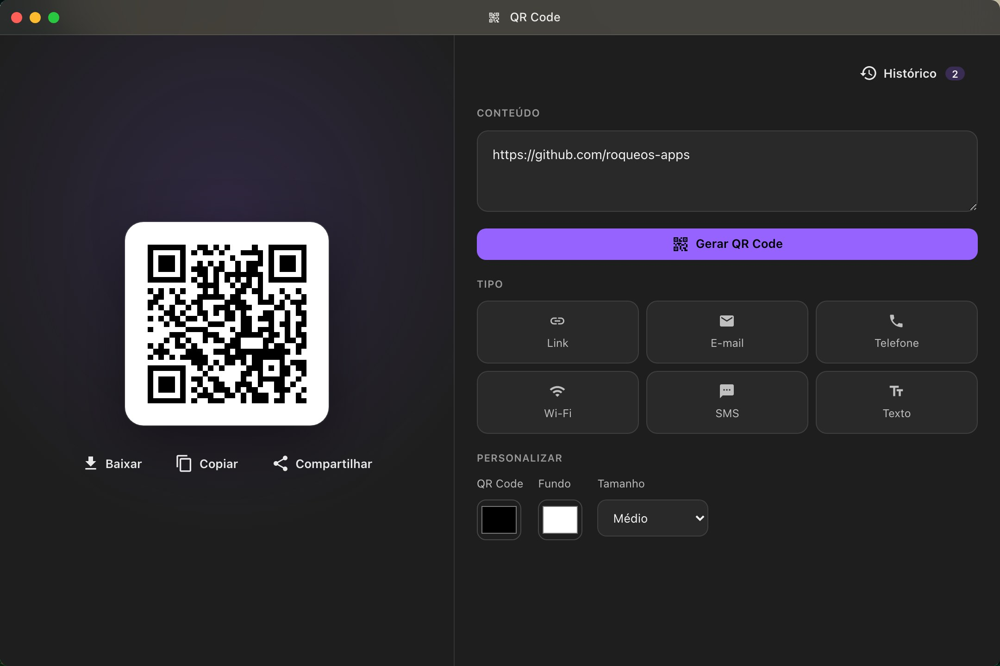
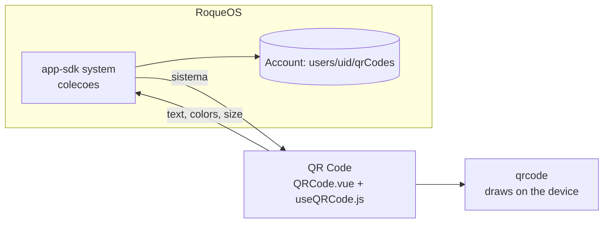

# QR Code

_English | [Português](README.pt-BR.md)_

The QR Code app of [RoqueOS](https://roqueos.com.br): it makes the code for a link, a Wi-Fi network, an email, a phone number, an SMS or any text, with the code color, the background color and the size you pick, and downloads, copies or shares the image. **The code is drawn on your own device**: the text is never sent to any service. With an account, every code you make goes into a history that follows you across devices. In all ten RoqueOS languages.

Use it for free at [roqueos.com.br](https://roqueos.com.br), on the computer, the phone and the TV.



## Why it exists as a repo

QR Code was born inside RoqueOS, which is closed. On 28/09/2026 it moved to its own repository in the [roqueos-apps](https://github.com/roqueos-apps) organization. RoqueOS installs it by tag, as a git dependency, and it talks to RoqueOS only through the [`app-sdk`](https://github.com/roqueos-apps/app-sdk). The screen is built with the [`ui`](https://github.com/roqueos-apps/ui) kit. The same code runs inside RoqueOS, alone in the browser (`yarn dev`) and in the tests.

The move fixed one thing: the old QR Code asked a third-party service (`api.qrserver.com`) for the image, with the text in the address, and stored that address in the history. The password of a Wi-Fi network in a QR code went outside. Now the [`qrcode`](https://github.com/soldair/node-qrcode) package draws it, in the browser, and the history keeps only the text and the choices ([CHANGELOG.md](CHANGELOG.md), 0.1.0).

## Getting started

You need Node 22 or newer (the [`.nvmrc`](.nvmrc) says 24) and Yarn 1.22.

```bash
git clone https://github.com/roqueos-apps/qrcode.git
cd qrcode
yarn install --frozen-lockfile --ignore-scripts
yarn dev          # QR Code in a fake RoqueOS window, with a local account
yarn verificar    # lint, format, tests and app check: the same as CI and pre-push
```

In the `yarn dev` window the history lives in `localStorage` and survives F5. `?idioma=ar-AR` opens it in Arabic, `?leve=1` as a low-end device sees it and `?convidado=1` without an account. The step by step, with what each command shows, is in [docs/GETTING-STARTED.md](docs/GETTING-STARTED.md).

## The parts



| Part                                   | What it is                                                                                                     |
| -------------------------------------- | -------------------------------------------------------------------------------------------------------------- |
| [`app.json`](app.json)                 | who it is: permanent id (`qrcode`), name and description in ten languages, icon, color, window, the capability |
| [`src/index.js`](src/index.js)         | `definirApp`: creates its own Vue app inside the element RoqueOS gives it                                      |
| [`src/QRCode.vue`](src/QRCode.vue)     | the screen: preview, actions, form, history and confirmation                                                   |
| [`src/useQRCode.js`](src/useQRCode.js) | the engine: generate, the history in the account, download, copy, share                                        |
| [`src/qr.js`](src/qr.js)               | what does not depend on the screen: types, the image, the history fields, ordering                             |
| [`src/textos.js`](src/textos.js)       | loads the language JSON (with `?raw`) and translates a key                                                     |
| [`i18n/`](i18n/)                       | the screen texts, one file per language                                                                        |
| [`dev/main.js`](dev/main.js)           | the `yarn dev`: QR Code in a fake RoqueOS window                                                               |
| [`test/`](test/)                       | Vitest: the app through the SDK, the logic and the language switch                                             |
| [`paridade.json`](paridade.json)       | the inventory of what the old app did and what happened to each item when it moved out                         |

What each button does: **Download** saves the PNG as `qrcode-<date>.png`; **Copy** copies the image where the browser copies images, and the code's text otherwise; **Share** opens the device's share sheet with the PNG and the text, and copies where there is no sheet; **Type** puts a template for link, email, phone, Wi-Fi or SMS in the field, in the person's language; **History** shows the 50 newest, with the thumbnail drawn on the device, and clearing it asks first ([`src/useQRCode.js`](src/useQRCode.js), [`src/qr.js`](src/qr.js)).

## Status and limits

Version 0.1.1 ([`package.json`](package.json), [CHANGELOG.md](CHANGELOG.md)). The app does not read QR codes, only makes them. Without an account the code appears the same way; it just does not enter the history, and the app says so. A text above 2,953 bytes does not fit in a QR code and the app warns instead of generating. Nothing was measured on a real iPhone ([`paridade.json`](paridade.json), `auditoria`). The known limits are in [docs/ARCHITECTURE.md](docs/ARCHITECTURE.md#9-known-limits).

## Documentation

Everything is reached from [docs/INDEX.md](docs/INDEX.md), in English, with the Portuguese pair in [docs/pt-BR/](docs/pt-BR/INDEX.md).

| Question                                   | Document                                           |
| ------------------------------------------ | -------------------------------------------------- |
| From zero to the code on screen            | [docs/GETTING-STARTED.md](docs/GETTING-STARTED.md) |
| How it is built inside                     | [docs/ARCHITECTURE.md](docs/ARCHITECTURE.md)       |
| Every command, file, field and text key    | [docs/REFERENCE.md](docs/REFERENCE.md)             |
| Maintaining, releasing, undoing            | [docs/OPERATIONS.md](docs/OPERATIONS.md)           |
| Something failed                           | [docs/WHEN-IT-BREAKS.md](docs/WHEN-IT-BREAKS.md)   |
| What a term means here                     | [docs/GLOSSARY.md](docs/GLOSSARY.md)               |
| Adding a type, a size or a text            | [docs/EXTENDING.md](docs/EXTENDING.md)             |
| How RoqueOS mounts it and what it receives | [docs/INTEGRATIONS.md](docs/INTEGRATIONS.md)       |
| What it protects and what it does not      | [docs/THREAT-MODEL.md](docs/THREAT-MODEL.md)       |
| What the tests prove                       | [docs/TESTING.md](docs/TESTING.md)                 |
| Contributing                               | [CONTRIBUTING.md](CONTRIBUTING.md)                 |

## Contributing

Read [CONTRIBUTING.md](CONTRIBUTING.md). Every commit carries `Signed-off-by` (DCO), and CI checks it. A security issue goes through [SECURITY.md](SECURITY.md), never a public issue.

## Credits and license

[MIT](LICENSE). The icons are [Material Icons](https://fonts.google.com/icons) (Apache-2.0), through the interface kit; see [ASSETS.md](ASSETS.md). The code is drawn by [qrcode](https://github.com/soldair/node-qrcode) (MIT). "QR Code" is a registered trademark of DENSO WAVE. The RoqueOS name and brand belong to LEVELHARD and are not covered by the license.
