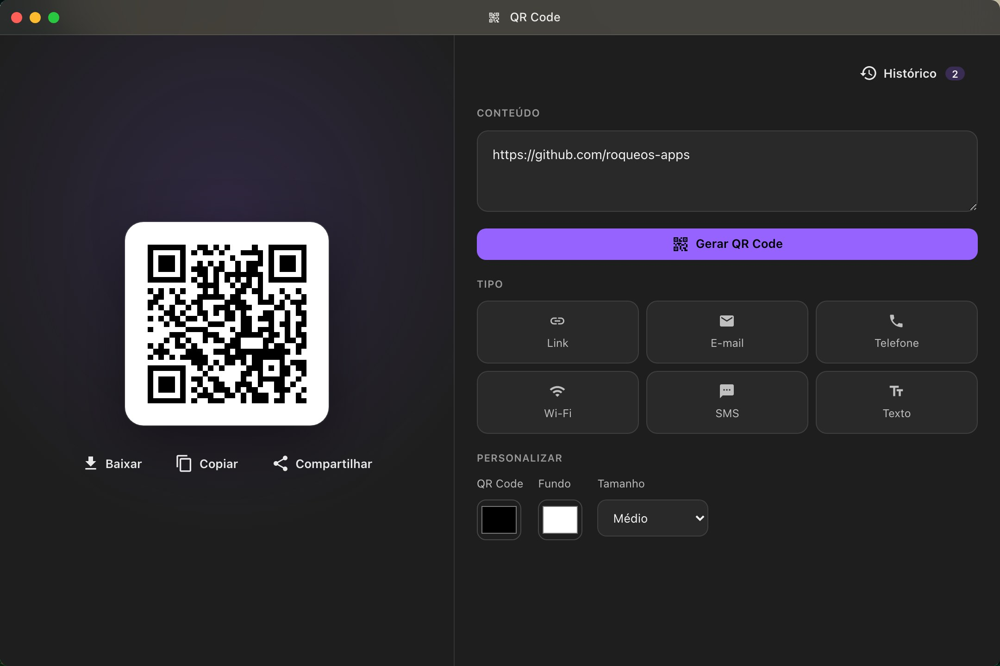
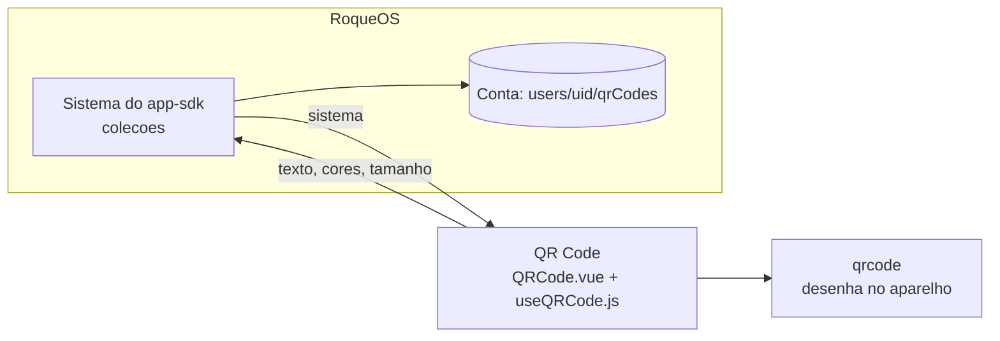

# QR Code

_[English](README.md) | Português_

O QR Code do [RoqueOS](https://roqueos.com.br): gera o código de um link, de uma rede Wi-Fi, de um e-mail, de um telefone, de um SMS ou de qualquer texto, com a cor do código, a cor do fundo e o tamanho que você escolher, e baixa, copia ou compartilha a imagem. **O código é desenhado no próprio aparelho**: o texto não vai para serviço nenhum. Com a conta, cada código gerado entra num histórico que volta em qualquer aparelho. Nos dez idiomas do RoqueOS.

Use de graça em [roqueos.com.br](https://roqueos.com.br), no computador, no celular e na TV.



## Por que existe como repo

O QR Code nasceu dentro do RoqueOS, que é fechado. Em 28/09/2026 ele saiu para o próprio repositório na organização [roqueos-apps](https://github.com/roqueos-apps). O RoqueOS o instala por uma tag, como dependência git, e ele fala com o RoqueOS só pelo [`app-sdk`](https://github.com/roqueos-apps/app-sdk). A tela é feita com o kit [`ui`](https://github.com/roqueos-apps/ui). O mesmo código roda dentro do RoqueOS, sozinho no navegador (`yarn dev`) e no teste.

A saída consertou uma coisa: o QR Code de antes pedia a imagem a um serviço de terceiros (`api.qrserver.com`) com o texto no endereço, e guardava esse endereço no histórico. A senha de um Wi-Fi em QR passava por fora. Agora quem desenha é o pacote [`qrcode`](https://github.com/soldair/node-qrcode), no navegador, e o histórico guarda só o texto e as escolhas ([CHANGELOG.md](CHANGELOG.md), 0.1.0).

## Como começar

Você precisa do Node 22 ou mais novo (o [`.nvmrc`](.nvmrc) diz 24) e do Yarn 1.22.

```bash
git clone https://github.com/roqueos-apps/qrcode.git
cd qrcode
yarn install --frozen-lockfile --ignore-scripts
yarn dev          # o QR Code numa janela falsa do RoqueOS, numa conta local
yarn verificar    # lint, formato, testes e app check: o mesmo do CI e do pre-push
```

Na janela do `yarn dev` o histórico fica no `localStorage` e continua depois do F5. `?idioma=ar-AR` abre em árabe, `?leve=1` como o aparelho fraco vê e `?convidado=1` sem conta. O passo a passo, com o que cada comando mostra, está em [docs/pt-BR/COMECAR.md](docs/pt-BR/COMECAR.md).

## As partes



| Parte                                  | O que é                                                                                                  |
| -------------------------------------- | -------------------------------------------------------------------------------------------------------- |
| [`app.json`](app.json)                 | quem ele é: id permanente (`qrcode`), nome e descrição nos dez idiomas, ícone, cor, janela, a capacidade |
| [`src/index.js`](src/index.js)         | `definirApp`: cria o app Vue próprio dentro do elemento que o RoqueOS dá                                 |
| [`src/QRCode.vue`](src/QRCode.vue)     | a tela: prévia, ações, formulário, histórico e confirmação                                               |
| [`src/useQRCode.js`](src/useQRCode.js) | o motor: gerar, o histórico na conta, baixar, copiar, compartilhar                                       |
| [`src/qr.js`](src/qr.js)               | o que não depende de tela: tipos, a imagem, os campos do histórico, ordem                                |
| [`src/textos.js`](src/textos.js)       | carrega o JSON do idioma (com `?raw`) e traduz uma chave                                                 |
| [`i18n/`](i18n/)                       | os textos da tela, um arquivo por idioma                                                                 |
| [`dev/main.js`](dev/main.js)           | o `yarn dev`: o QR Code numa janela falsa do RoqueOS                                                     |
| [`test/`](test/)                       | Vitest: o app pelo SDK, a lógica e a troca de idioma                                                     |
| [`paridade.json`](paridade.json)       | o inventário do que o app de antes fazia e do que aconteceu com cada coisa na saída                      |

O que cada botão faz: **Baixar** salva o PNG com o nome `qrcode-<data>.png`; **Copiar** copia a imagem onde o navegador copia imagem, e o texto do código onde não copia; **Compartilhar** abre a folha de compartilhar do aparelho com o PNG e o texto, e copia onde não há folha; **Tipo** põe no campo um modelo de link, e-mail, telefone, Wi-Fi ou SMS, no idioma da pessoa; **Histórico** mostra as 50 mais novas, com a miniatura desenhada no aparelho, e limpar pede confirmação ([`src/useQRCode.js`](src/useQRCode.js), [`src/qr.js`](src/qr.js)).

## Estado e limites

Versão 0.1.1 ([`package.json`](package.json), [CHANGELOG.md](CHANGELOG.md)). O app não lê QR Code, só gera. Sem conta o código aparece do mesmo jeito; só não entra no histórico, e o app avisa. Texto acima de 2.953 bytes não cabe num QR Code e o app avisa em vez de gerar. Nada foi medido no iPhone real ([`paridade.json`](paridade.json), `auditoria`). Os limites conhecidos estão em [docs/pt-BR/ARQUITETURA.md](docs/pt-BR/ARQUITETURA.md#9-limites-conhecidos).

## Documentação

Tudo sai de [docs/pt-BR/INDEX.md](docs/pt-BR/INDEX.md), em português, com o principal em inglês em [docs/](docs/INDEX.md).

| Pergunta                                      | Documento                                                          |
| --------------------------------------------- | ------------------------------------------------------------------ |
| Do zero ao código na tela                     | [docs/pt-BR/COMECAR.md](docs/pt-BR/COMECAR.md)                     |
| Como é por dentro                             | [docs/pt-BR/ARQUITETURA.md](docs/pt-BR/ARQUITETURA.md)             |
| Todo comando, arquivo, campo e chave de texto | [docs/pt-BR/REFERENCIA.md](docs/pt-BR/REFERENCIA.md)               |
| Manter, publicar, desfazer                    | [docs/pt-BR/OPERACAO.md](docs/pt-BR/OPERACAO.md)                   |
| Algo falhou                                   | [docs/pt-BR/QUANDO-QUEBRA.md](docs/pt-BR/QUANDO-QUEBRA.md)         |
| O que um termo quer dizer aqui                | [docs/pt-BR/GLOSSARIO.md](docs/pt-BR/GLOSSARIO.md)                 |
| Acrescentar um tipo, um tamanho ou um texto   | [docs/pt-BR/ESTENDER.md](docs/pt-BR/ESTENDER.md)                   |
| Como o RoqueOS o monta e o que ele recebe     | [docs/pt-BR/INTEGRACOES.md](docs/pt-BR/INTEGRACOES.md)             |
| O que protege e o que não protege             | [docs/pt-BR/MODELO-DE-AMEACAS.md](docs/pt-BR/MODELO-DE-AMEACAS.md) |
| O que os testes provam                        | [docs/pt-BR/TESTES.md](docs/pt-BR/TESTES.md)                       |
| Contribuir                                    | [docs/pt-BR/CONTRIBUTING.md](docs/pt-BR/CONTRIBUTING.md)           |

## Contribuir

Leia o [docs/pt-BR/CONTRIBUTING.md](docs/pt-BR/CONTRIBUTING.md). Todo commit leva `Signed-off-by` (DCO), e o CI confere. Falha de segurança vai pelo [SECURITY.md](SECURITY.md), nunca por issue pública.

## Créditos e licença

[MIT](LICENSE). Os ícones são do [Material Icons](https://fonts.google.com/icons) (Apache-2.0), pelo kit de interface; veja o [ASSETS.md](ASSETS.md). O código é desenhado pelo [qrcode](https://github.com/soldair/node-qrcode) (MIT). "QR Code" é marca registrada da DENSO WAVE. O nome e a marca RoqueOS são da LEVELHARD e não fazem parte da licença.
