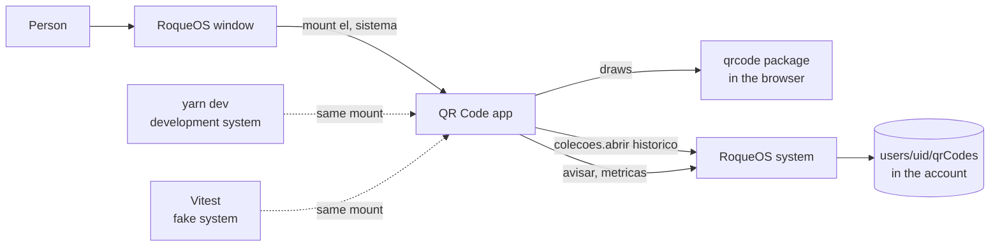
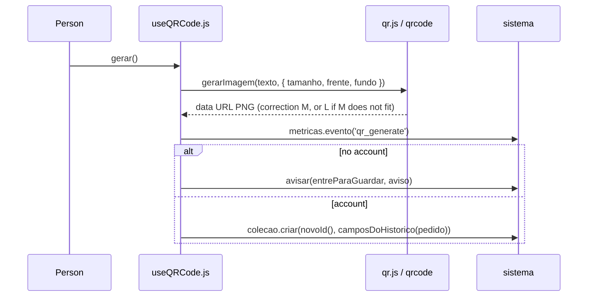
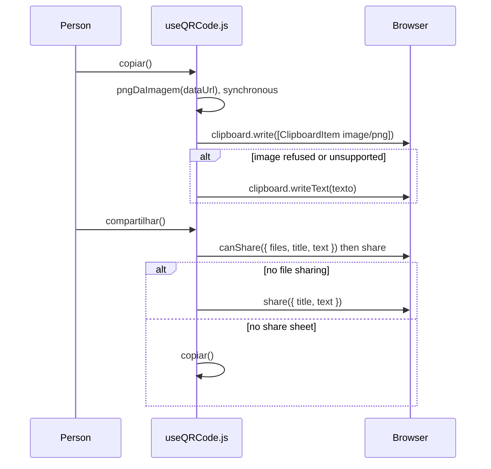

# Architecture

_English | [Português](pt-BR/ARQUITETURA.md)_

> **Who it is for:** whoever changes the app and needs to know what holds it together before touching it.
> **What is here:** the idea, the context, where it runs, the components with their files, the main flows in sequence diagrams, the data, secrets, the design decisions and the known limits.
> **Where to go for the rest:** each file and field one by one, in [REFERENCE.md](REFERENCE.md); what RoqueOS delivers, in [INTEGRATIONS.md](INTEGRATIONS.md); what this protects, in [THREAT-MODEL.md](THREAT-MODEL.md).

## Contents

1. [The idea](#1-the-idea)
2. [Context](#2-context)
3. [Processes and where they run](#3-processes-and-where-they-run)
4. [Components](#4-components)
5. [Main flows](#5-main-flows)
6. [Data and contracts](#6-data-and-contracts)
7. [Secrets](#7-secrets)
8. [Design decisions](#8-design-decisions)
9. [Known limits](#9-known-limits)
10. [How the diagrams are made](#10-how-the-diagrams-are-made)

## 1. The idea

QR Code is a small Vue app that RoqueOS mounts inside a window. It receives a `sistema` from the [`app-sdk`](https://github.com/roqueos-apps/app-sdk) and talks to RoqueOS only through it; the image is drawn in the browser by the [`qrcode`](https://github.com/soldair/node-qrcode) package, and the only thing that leaves the device is the history entry (the text, the colors, the size and the type), which the system keeps in the person's account. The same `mount` runs inside RoqueOS, in the SDK's development window (`yarn dev`) and against the SDK's fake system in the tests ([`src/index.js`](../src/index.js)).

## 2. Context



Who uses it: the person, inside RoqueOS on computer, phone or TV ([README.md](../README.md)). What it depends on: RoqueOS for the window, the language, the notices, the metrics and the collection; the `qrcode` package for the image; the `ui` kit for the buttons, the sheet, the confirmation and the empty state ([`src/QRCode.vue`](../src/QRCode.vue)). What happens when something is missing: without an account the code is drawn the same way and the app says it will not enter the history (`entreParaGuardar`); when the collection refuses a write the code stays on screen and the app shows `erroAoGuardar`; a system without `colecoes` is refused at mount, with the reason ([`src/useQRCode.js`](../src/useQRCode.js), [`test/app.spec.js`](../test/app.spec.js)). The history needs RoqueOS's backend; drawing does not need the network at all.

## 3. Processes and where they run

| Process                | Where it runs                                             | Who starts it                                                                                     |
| ---------------------- | --------------------------------------------------------- | ------------------------------------------------------------------------------------------------- |
| the app inside RoqueOS | the RoqueOS page, same origin, its own Vue app            | RoqueOS, from the installed `@roqueos-apps/qrcode` package                                        |
| the development window | Vite on `localhost`, [`dev/main.js`](../dev/main.js)      | `yarn dev`                                                                                        |
| the tests              | Vitest with jsdom ([`vite.config.js`](../vite.config.js)) | `yarn test`, inside `yarn verificar`                                                              |
| the gate in CI         | GitHub Actions, `ubuntu-latest`, read-only, no secrets    | push to `main` and every pull request ([`.github/workflows/ci.yml`](../.github/workflows/ci.yml)) |
| the DCO check          | GitHub Actions, on pull requests                          | [`.github/workflows/dco.yml`](../.github/workflows/dco.yml)                                       |

There is no server, no worker and no build of this repo that ships: RoqueOS compiles the package with its own Vite, and this repo's [`vite.config.js`](../vite.config.js) is only for `yarn dev` and `yarn test`.

## 4. Components

| Component   | File                                                     | What it does                                                                                                                  |
| ----------- | -------------------------------------------------------- | ----------------------------------------------------------------------------------------------------------------------------- |
| entry point | [`src/index.js`](../src/index.js)                        | `definirApp` with id `qrcode` and capability `colecoes`; loads the texts, then mounts the Vue app; follows language changes   |
| screen      | [`src/QRCode.vue`](../src/QRCode.vue)                    | preview, buttons, form, history sheet (`RosFolha`), clear confirmation (`RosConfirmar`), thumbnails                           |
| engine      | [`src/useQRCode.js`](../src/useQRCode.js)                | `criarQRCode`: form state, `gerar`, `abrirDoHistorico`, `limparHistorico`, `baixar`, `copiar`, `compartilhar`                 |
| logic       | [`src/qr.js`](../src/qr.js)                              | `TIPOS`, `TAMANHOS`, `gerarImagem` (M then L), `camposDoHistorico`, `lerEntrada`, `ordenarHistorico`, `pngDaImagem`, `novoId` |
| texts       | [`src/textos.js`](../src/textos.js), [`i18n/`](../i18n/) | static map of ten loaders with `?raw`, `traduzir`                                                                             |
| style       | [`src/qr.scss`](../src/qr.scss)                          | `--qr-*` variables on top of the SDK's `--ros-*`; one column below 700 px of container width                                  |
| manifest    | [`app.json`](../app.json)                                | id, names, descriptions, icon `qr_code_2`, color `#8b5cf6`, window, `capacidades`, `colecoes`                                 |
| parity      | [`paridade.json`](../paridade.json)                      | 55 items (37 kept, 18 changed, 0 lost) that RoqueOS checks in the installed package                                           |

## 5. Main flows

### 5.1 Mounting

```mermaid
sequenceDiagram
  participant R as RoqueOS
  participant I as src/index.js
  participant T as src/textos.js
  participant V as QRCode.vue
  R->>I: mount(el, sistema, { ativo })
  I->>I: definirApp checks the system has colecoes
  I->>T: carregarTextos(sistema.idioma.atual())
  T-->>I: JSON.parse of i18n/<language>.json?raw
  I->>V: createApp(QRCode, { sistema, estado }).mount(el)
  V->>R: colecoes.abrir('historico').observar(...)
  R-->>V: the list of entries
  Note over I: idioma.aoMudar reloads the texts; the last request wins
```

The app mounts only with the texts in hand, so no button appears without a label ([`src/index.js`](../src/index.js)). Two language changes in a row can come back out of order; a counter keeps the last one ([`test/troca-de-idioma.spec.js`](../test/troca-de-idioma.spec.js)).

### 5.2 Generating and saving



A text that does not fit even with correction L rejects with `codigo: 'longo-demais'`, the app warns `longoDemais` and nothing is saved ([`src/qr.js`](../src/qr.js)). Opening a history entry draws it again without creating another entry (`abrirDoHistorico`).

### 5.3 Copying and sharing



Nothing is awaited before the clipboard or the share sheet is called, because Safari on iPhone accepts both only inside the person's tap ([`src/qr.js`](../src/qr.js), `pngDaImagem`). Cancelling the sheet (`AbortError`) copies nothing.

## 6. Data and contracts

The history is the collection `historico`, which RoqueOS maps to `users/{uid}/qrCodes` in the account ([CLAUDE.md](../CLAUDE.md)). An entry written by this app, as [`camposDoHistorico`](../src/qr.js) builds it:

```json
{
  "text": "WIFI:T:WPA;S:NomeDaRede;P:SenhaDoWiFi;;",
  "size": 300,
  "fgColor": "#000000",
  "bgColor": "#ffffff",
  "preset": "wifi"
}
```

The system stamps `criadoEm`. Entries written before 28/09/2026 also carry `url` (the third-party address), `createdAtMs` and `createdBy`; `lerEntrada` reads `createdAtMs` when `criadoEm` is missing and never reads the other two ([`test/app.spec.js`](../test/app.spec.js), `antiga`). The document id is `qr_<ms>_<base36>`, inside the `[A-Za-z0-9_-]` the SDK accepts (`novoId`).

The contract with RoqueOS is the SDK's: `mount(el, sistema, opcoes)` returning `{ ativar, desmontar }`, the capabilities in [`app.json`](../app.json), and the package exports `.` and `./app.json` ([`package.json`](../package.json)). Details in [INTEGRATIONS.md](INTEGRATIONS.md).

## 7. Secrets

The repo has none and needs none: no API key, no token, no `.env`. CI reads no secret ([`.github/workflows/ci.yml`](../.github/workflows/ci.yml)). The sensitive data is the person's: the text of a code can be a Wi-Fi password, which is why it never goes to a third party and why the history keeps text and not an image URL ([THREAT-MODEL.md](THREAT-MODEL.md)).

## 8. Design decisions

| Decided                                                                    | Refused alternative                                 | Why                                                                                                                             | When               |
| -------------------------------------------------------------------------- | --------------------------------------------------- | ------------------------------------------------------------------------------------------------------------------------------- | ------------------ |
| draw the code on the device with `qrcode`                                  | keep `api.qrserver.com`                             | the text, sometimes a Wi-Fi password, went to a third party in the URL and the URL stayed in the history                        | 28/09/2026 (0.1.0) |
| keep the field names `text`, `size`, `fgColor`, `bgColor`, `preset`        | rename them to Portuguese                           | the history of whoever already used the app keeps working                                                                       | 28/09/2026         |
| correction M, falling back to L                                            | always M, or always L                               | M survives a scratched code; L fits up to 2,953 bytes, which the old service accepted                                           | 28/09/2026 (0.1.1) |
| `pngDaImagem` synchronous                                                  | `await fetch(dataUrl)`                              | Safari on iPhone accepts clipboard and share only inside the tap                                                                | 28/09/2026 (0.1.1) |
| texts as `?raw` plus `JSON.parse`, capabilities repeated in `src/index.js` | `import` of JSON                                    | RoqueOS's build breaks on direct JSON import outside its `src/i18n/` (measured in the games, 25/09/2026)                        | 28/09/2026         |
| static map of language loaders                                             | `import(variable)`                                  | Vite gives up splitting and bundles the ten languages together, silently ([`src/textos.js`](../src/textos.js))                  | 28/09/2026         |
| generate without an account, history only with one                         | refuse to generate without an account (the old app) | the code is born on the device and does not need the account                                                                    | 28/09/2026         |
| clear the history one document at a time                                   | one batch delete                                    | the capability deletes one id per call, and old histories could pass a thousand entries                                         | 28/09/2026         |
| `aria-disabled` on Clear, not `disabled`                                   | `disabled`                                          | a focused button that becomes `disabled` drops focus to `body` in Chromium, and Esc no longer closes the sheet (QA, 28/09/2026) | 28/09/2026         |
| `id` `qrcode` and collection `historico` permanent                         | rename freely                                       | RoqueOS finds windows, shortcuts and the history by them ([CONTRIBUTING.md](../CONTRIBUTING.md))                                | 28/09/2026         |

The dates come from [CHANGELOG.md](../CHANGELOG.md), the comments in the files cited and [`paridade.json`](../paridade.json).

## 9. Known limits

- It does not read QR codes; the description said "Generate and scan" until 0.1.0 and the app never scanned ([CHANGELOG.md](../CHANGELOG.md)).
- Above 2,953 bytes nothing fits; the app warns (`longoDemais`).
- The screen shows the 50 newest entries (`LIMITE_DO_HISTORICO`); the older ones stay in the account and are deleted by Clear, but are not shown.
- Copying an image depends on `ClipboardItem`; where it is missing, the text is copied instead.
- Nothing was measured on a real iPhone; the Safari behavior is proven only by the synchronous path in the tests ([`paridade.json`](../paridade.json), `auditoria`).
- The first opening time with a cold cache was not measured ([`paridade.json`](../paridade.json), item 54).
- The development window and the fake system implement the same contract as RoqueOS, but the RoqueOS collection itself (rules, offline behavior) is not exercised in this repo.

## 10. How the diagrams are made

All diagrams are Mermaid inside the Markdown, rendered by GitHub; the Portuguese pair translates the labels. The cover [`capa.jpg`](capa.jpg) is a screenshot, not a diagram, with its origin in [ASSETS.md](../ASSETS.md). The list is in [INDEX.md](INDEX.md#diagrams).
