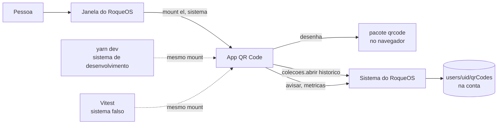
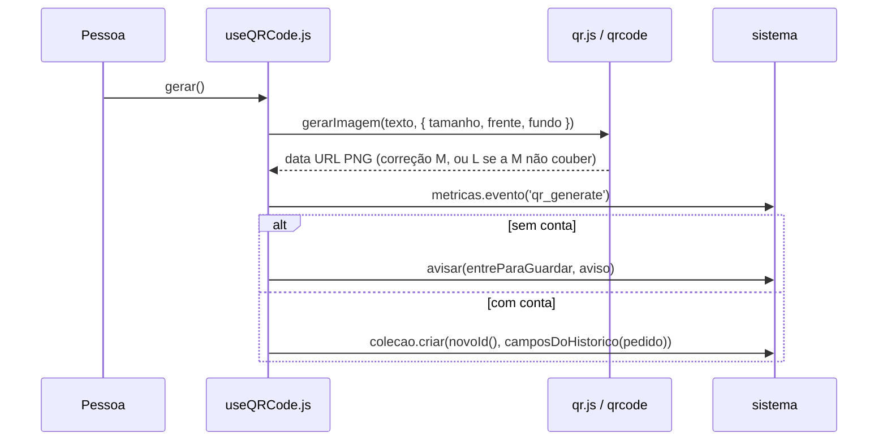
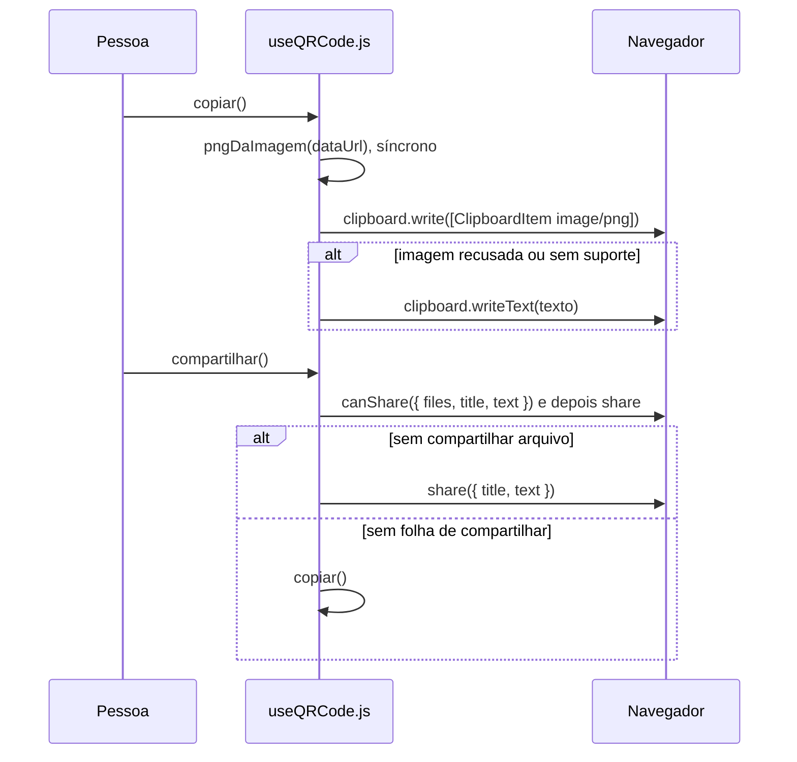

# Arquitetura

_[English](../ARCHITECTURE.md) | Português_

> **Para quem:** quem vai mudar o app e precisa saber o que o segura antes de mexer.
> **O que tem aqui:** a ideia, o contexto, onde roda, os componentes com o arquivo de cada um, os fluxos principais em diagrama de sequência, os dados, segredos, as decisões de design e os limites conhecidos.
> **Onde ir para o resto:** cada arquivo e campo um a um, em [REFERENCIA.md](REFERENCIA.md); o que o RoqueOS entrega, em [INTEGRACOES.md](INTEGRACOES.md); o que isto protege, em [MODELO-DE-AMEACAS.md](MODELO-DE-AMEACAS.md).

## Sumário

1. [A ideia](#1-a-ideia)
2. [Contexto](#2-contexto)
3. [Processos e onde rodam](#3-processos-e-onde-rodam)
4. [Componentes](#4-componentes)
5. [Fluxos principais](#5-fluxos-principais)
6. [Dados e contratos](#6-dados-e-contratos)
7. [Segredos](#7-segredos)
8. [Decisões de design](#8-decisões-de-design)
9. [Limites conhecidos](#9-limites-conhecidos)
10. [Como os diagramas são feitos](#10-como-os-diagramas-são-feitos)

## 1. A ideia

O QR Code é um app Vue pequeno que o RoqueOS monta dentro de uma janela. Ele recebe um `sistema` do [`app-sdk`](https://github.com/roqueos-apps/app-sdk) e fala com o RoqueOS só por ele; a imagem é desenhada no navegador pelo pacote [`qrcode`](https://github.com/soldair/node-qrcode), e a única coisa que sai do aparelho é a entrada do histórico (o texto, as cores, o tamanho e o tipo), que o sistema guarda na conta da pessoa. O mesmo `mount` roda dentro do RoqueOS, na janela de desenvolvimento do SDK (`yarn dev`) e contra o sistema falso do SDK no teste ([`src/index.js`](../../src/index.js)).

## 2. Contexto



Quem usa: a pessoa, dentro do RoqueOS, no computador, no celular ou na TV ([README.pt-BR.md](../../README.pt-BR.md)). Do que depende: do RoqueOS para a janela, o idioma, os avisos, as métricas e a coleção; do pacote `qrcode` para a imagem; do kit `ui` para os botões, a folha, a confirmação e o estado vazio ([`src/QRCode.vue`](../../src/QRCode.vue)). O que acontece quando falta algo: sem conta o código é desenhado do mesmo jeito e o app avisa que não vai para o histórico (`entreParaGuardar`); quando a coleção recusa a gravação, o código fica na tela e o app mostra `erroAoGuardar`; sistema sem `colecoes` é recusado no mount, com o motivo ([`src/useQRCode.js`](../../src/useQRCode.js), [`test/app.spec.js`](../../test/app.spec.js)). O histórico precisa do backend do RoqueOS; desenhar não precisa de rede nenhuma.

## 3. Processos e onde rodam

| Processo                    | Onde roda                                                   | Quem inicia                                                                                       |
| --------------------------- | ----------------------------------------------------------- | ------------------------------------------------------------------------------------------------- |
| o app dentro do RoqueOS     | a página do RoqueOS, mesma origem, app Vue próprio          | o RoqueOS, a partir do pacote `@roqueos-apps/qrcode` instalado                                    |
| a janela de desenvolvimento | Vite no `localhost`, [`dev/main.js`](../../dev/main.js)     | `yarn dev`                                                                                        |
| os testes                   | Vitest com jsdom ([`vite.config.js`](../../vite.config.js)) | `yarn test`, dentro do `yarn verificar`                                                           |
| o gate no CI                | GitHub Actions, `ubuntu-latest`, só leitura, sem segredo    | push na `main` e todo pull request ([`.github/workflows/ci.yml`](../../.github/workflows/ci.yml)) |
| a conferência do DCO        | GitHub Actions, nos pull requests                           | [`.github/workflows/dco.yml`](../../.github/workflows/dco.yml)                                    |

Não há servidor, nem worker, nem build deste repo que vá para produção: o RoqueOS compila o pacote com o Vite dele, e o [`vite.config.js`](../../vite.config.js) daqui serve só ao `yarn dev` e ao `yarn test`.

## 4. Componentes

| Componente       | Arquivo                                                        | O que faz                                                                                                                         |
| ---------------- | -------------------------------------------------------------- | --------------------------------------------------------------------------------------------------------------------------------- |
| porta de entrada | [`src/index.js`](../../src/index.js)                           | `definirApp` com id `qrcode` e capacidade `colecoes`; carrega os textos, depois monta o app Vue; acompanha a troca de idioma      |
| tela             | [`src/QRCode.vue`](../../src/QRCode.vue)                       | prévia, botões, formulário, folha do histórico (`RosFolha`), confirmação de limpar (`RosConfirmar`), miniaturas                   |
| motor            | [`src/useQRCode.js`](../../src/useQRCode.js)                   | `criarQRCode`: estado do formulário, `gerar`, `abrirDoHistorico`, `limparHistorico`, `baixar`, `copiar`, `compartilhar`           |
| lógica           | [`src/qr.js`](../../src/qr.js)                                 | `TIPOS`, `TAMANHOS`, `gerarImagem` (M e depois L), `camposDoHistorico`, `lerEntrada`, `ordenarHistorico`, `pngDaImagem`, `novoId` |
| textos           | [`src/textos.js`](../../src/textos.js), [`i18n/`](../../i18n/) | mapa estático de dez carregadores com `?raw`, `traduzir`                                                                          |
| visual           | [`src/qr.scss`](../../src/qr.scss)                             | variáveis `--qr-*` em cima das `--ros-*` do SDK; uma coluna abaixo de 700 px de largura do contêiner                              |
| manifesto        | [`app.json`](../../app.json)                                   | id, nomes, descrições, ícone `qr_code_2`, cor `#8b5cf6`, janela, `capacidades`, `colecoes`                                        |
| paridade         | [`paridade.json`](../../paridade.json)                         | 55 itens (37 mantidas, 18 mudaram, 0 perdidas) que o RoqueOS confere no pacote instalado                                          |

## 5. Fluxos principais

### 5.1 Montar

```mermaid
sequenceDiagram
  participant R as RoqueOS
  participant I as src/index.js
  participant T as src/textos.js
  participant V as QRCode.vue
  R->>I: mount(el, sistema, { ativo })
  I->>I: definirApp confere que o sistema tem colecoes
  I->>T: carregarTextos(sistema.idioma.atual())
  T-->>I: JSON.parse de i18n/<idioma>.json?raw
  I->>V: createApp(QRCode, { sistema, estado }).mount(el)
  V->>R: colecoes.abrir('historico').observar(...)
  R-->>V: a lista de entradas
  Note over I: idioma.aoMudar recarrega os textos; vale o último pedido
```

O app só monta com os textos na mão, para nenhum botão aparecer sem rótulo ([`src/index.js`](../../src/index.js)). Duas trocas de idioma seguidas podem voltar fora de ordem; um contador fica com a última ([`test/troca-de-idioma.spec.js`](../../test/troca-de-idioma.spec.js)).

### 5.2 Gerar e guardar



Texto que não cabe nem com a correção L rejeita com `codigo: 'longo-demais'`, o app avisa `longoDemais` e nada é guardado ([`src/qr.js`](../../src/qr.js)). Abrir uma entrada do histórico desenha de novo sem criar outra entrada (`abrirDoHistorico`).

### 5.3 Copiar e compartilhar



Nada é esperado antes de chamar a área de transferência ou a folha de compartilhar, porque o Safari do iPhone só aceita as duas dentro do toque da pessoa ([`src/qr.js`](../../src/qr.js), `pngDaImagem`). Cancelar a folha (`AbortError`) não copia nada.

## 6. Dados e contratos

O histórico é a coleção `historico`, que o RoqueOS mapeia para `users/{uid}/qrCodes` na conta ([CLAUDE.md](../../CLAUDE.md)). Uma entrada gravada por este app, como o [`camposDoHistorico`](../../src/qr.js) monta:

```json
{
  "text": "WIFI:T:WPA;S:NomeDaRede;P:SenhaDoWiFi;;",
  "size": 300,
  "fgColor": "#000000",
  "bgColor": "#ffffff",
  "preset": "wifi"
}
```

O sistema carimba o `criadoEm`. Entradas gravadas antes de 28/09/2026 trazem também `url` (o endereço do terceiro), `createdAtMs` e `createdBy`; o `lerEntrada` lê o `createdAtMs` quando falta o `criadoEm` e nunca lê os outros dois ([`test/app.spec.js`](../../test/app.spec.js), `antiga`). O id do documento é `qr_<ms>_<base36>`, dentro do `[A-Za-z0-9_-]` que o SDK aceita (`novoId`).

O contrato com o RoqueOS é o do SDK: `mount(el, sistema, opcoes)` devolvendo `{ ativar, desmontar }`, as capacidades do [`app.json`](../../app.json) e as saídas `.` e `./app.json` do pacote ([`package.json`](../../package.json)). Detalhes em [INTEGRACOES.md](INTEGRACOES.md).

## 7. Segredos

O repo não tem e não precisa de nenhum: nem chave de API, nem token, nem `.env`. O CI não lê segredo ([`.github/workflows/ci.yml`](../../.github/workflows/ci.yml)). O dado sensível é o da pessoa: o texto de um código pode ser a senha de um Wi-Fi, e é por isso que ele nunca vai para terceiro e que o histórico guarda texto e não URL de imagem ([MODELO-DE-AMEACAS.md](MODELO-DE-AMEACAS.md)).

## 8. Decisões de design

| Decidido                                                                  | Alternativa recusada                     | Por quê                                                                                                               | Quando             |
| ------------------------------------------------------------------------- | ---------------------------------------- | --------------------------------------------------------------------------------------------------------------------- | ------------------ |
| desenhar o código no aparelho com o `qrcode`                              | manter o `api.qrserver.com`              | o texto, às vezes a senha do Wi-Fi, ia para um terceiro na URL, e a URL ficava no histórico                           | 28/09/2026 (0.1.0) |
| manter os nomes de campo `text`, `size`, `fgColor`, `bgColor`, `preset`   | renomear para português                  | o histórico de quem já usava continua valendo                                                                         | 28/09/2026         |
| correção M, com recuo para a L                                            | sempre M, ou sempre L                    | a M aguenta o código riscado; a L faz caber até 2.953 bytes, o que o serviço de antes aceitava                        | 28/09/2026 (0.1.1) |
| `pngDaImagem` síncrono                                                    | `await fetch(dataUrl)`                   | o Safari do iPhone só aceita área de transferência e compartilhar dentro do toque                                     | 28/09/2026 (0.1.1) |
| textos com `?raw` e `JSON.parse`, capacidades repetidas no `src/index.js` | `import` de JSON                         | o build do RoqueOS quebra com import de JSON direto fora do `src/i18n/` dele (medido nos jogos, 25/09/2026)           | 28/09/2026         |
| mapa estático de carregadores de idioma                                   | `import(variável)`                       | o Vite desiste de recortar e empacota os dez idiomas juntos, calado ([`src/textos.js`](../../src/textos.js))          | 28/09/2026         |
| gerar sem conta, histórico só com conta                                   | recusar gerar sem conta (o app de antes) | o código nasce no aparelho e não precisa da conta                                                                     | 28/09/2026         |
| limpar o histórico um documento por vez                                   | uma exclusão em lote                     | a capacidade apaga um id por chamada, e o histórico de antes podia passar de mil entradas                             | 28/09/2026         |
| `aria-disabled` no Limpar, e não `disabled`                               | `disabled`                               | botão com foco que vira `disabled` joga o foco no `body` no Chromium, e o Esc não fecha mais a folha (QA, 28/09/2026) | 28/09/2026         |
| `id` `qrcode` e coleção `historico` permanentes                           | renomear à vontade                       | é por eles que o RoqueOS acha janelas, atalhos e o histórico ([CONTRIBUTING.md](CONTRIBUTING.md))                     | 28/09/2026         |

As datas vêm do [CHANGELOG.md](../../CHANGELOG.md), dos comentários dos arquivos citados e do [`paridade.json`](../../paridade.json).

## 9. Limites conhecidos

- Não lê QR Code; a descrição dizia "Gere e escaneie" até a 0.1.0 e o app nunca leu ([CHANGELOG.md](../../CHANGELOG.md)).
- Acima de 2.953 bytes nada cabe; o app avisa (`longoDemais`).
- A tela mostra as 50 entradas mais novas (`LIMITE_DO_HISTORICO`); as mais velhas ficam na conta e o Limpar apaga, mas não aparecem.
- Copiar a imagem depende do `ClipboardItem`; onde falta, o texto é copiado no lugar.
- Nada foi medido no iPhone real; o comportamento do Safari só está provado pelo caminho síncrono nos testes ([`paridade.json`](../../paridade.json), `auditoria`).
- O tempo da primeira abertura com cache frio não foi medido ([`paridade.json`](../../paridade.json), item 54).
- A janela de desenvolvimento e o sistema falso implementam o mesmo contrato que o RoqueOS, mas a coleção de verdade do RoqueOS (regras, comportamento sem rede) não é exercitada neste repo.

## 10. Como os diagramas são feitos

Todos os diagramas são Mermaid dentro do Markdown, desenhados pelo GitHub; o par em português traduz os rótulos. A capa [`capa.jpg`](../capa.jpg) é um print, não um diagrama, com a origem no [ASSETS.md](../../ASSETS.md). A lista está no [INDEX.md](INDEX.md#diagramas).
